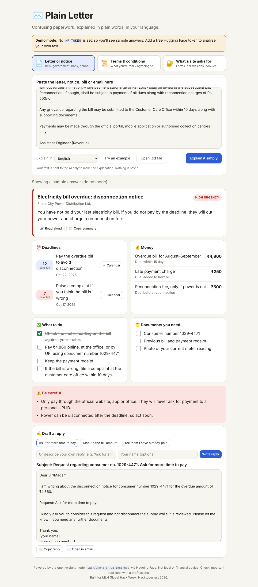
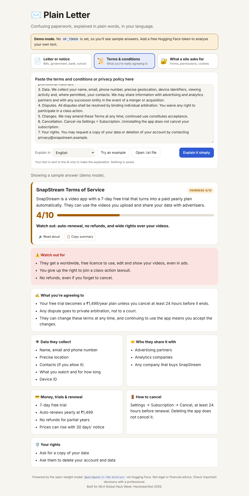
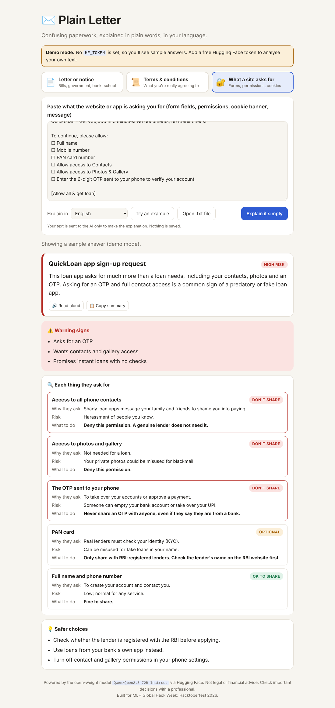

# ✉️ Plain Letter

**Confusing paperwork, explained in plain words, in your language.**

Plain Letter uses an **open-weight AI model** to turn three kinds of confusing text into something anyone can act on:

| Mode | You paste… | You get… |
|---|---|---|
| 📄 **Letter or notice** | A bill, government notice, bank, school or legal letter | A 2-line summary, urgency level, **deadline countdowns with calendar reminders**, money owed, a **tick-off checklist** of actions, documents to gather, red flags, and **one-tap reply drafts** |
| 📜 **Terms & conditions** | A website or app's terms of service or privacy policy | A **fairness score out of 10**, what you're really agreeing to, data collected, who it's shared with, auto-renewals and fees, how to cancel, your rights, and unfair clauses |
| 🔐 **What a site asks for** | A sign-up form, KYC request, app permissions, cookie banner or "verify your account" message | Every item rated **OK to share / Optional / Don't share**, with why they want it, the risk, and what to do instead |

Every result can be shown in **16 languages** (English, Hindi, Malayalam, Tamil, Telugu, Kannada, Bengali, Marathi, Gujarati, Punjabi, Urdu, Spanish, French, Arabic, Portuguese and Chinese), **read aloud**, and copied.

Built for **MLH Global Hack Week: Hacktoberfest 2026**, whose theme is open-weight AI: *"AI belongs to everyone."*

## Screenshots

| Letter | Terms & conditions | What a site asks for |
|---|---|---|
|  |  |  |

## Why

Millions of people sign things they don't understand. Elderly parents get disconnection notices. Immigrants get letters in legal language that isn't their first language. Everyone clicks "I agree" on terms nobody reads, and loan apps ask for your contacts and OTP. A general chatbot *can* help, but only if you know what to ask. Plain Letter asks the right questions for you and turns the answer into deadlines, checklists and clear yes/no decisions.

## Why open-weight AI?

Paperwork is personal. Plain Letter runs on an **open-weight model** (default: `Qwen/Qwen2.5-72B-Instruct`) through [Hugging Face Inference Providers](https://huggingface.co/docs/inference-providers), so:

- the model is public and can be audited, not a black box;
- you can swap in any open model (Llama, Gemma, Mistral, …) with one environment variable;
- anyone who wants full privacy can point it at their own self-hosted copy of the same model.

Nothing runs on your computer, and the app stores nothing: text goes to the model, the explanation comes back, and that's it.

## Run it

```bash
git clone <this repo> && cd <repo>
python3 -m venv .venv && source .venv/bin/activate
pip install -r requirements.txt
cp .env.example .env        # then paste your token into .env
python app.py               # open http://localhost:5000
```

**Get a free token:** go to [huggingface.co/settings/tokens](https://huggingface.co/settings/tokens) → *Create new token* → *Fine-grained* → tick **"Make calls to Inference Providers"**.

**No token?** The app starts in **demo mode** with sample answers for each "Try an example" text, so you can explore the whole interface.

### Change the model

Set `HF_MODEL` in `.env` to any chat model served by Hugging Face Inference Providers, e.g. `meta-llama/Llama-3.3-70B-Instruct`.

### Deploy

It's a standard Flask app with a `Procfile`. On Render, Railway, Heroku or DigitalOcean App Platform: connect the repo, set `HF_TOKEN` as an environment variable, and use the start command `gunicorn app:app`.

### Tests

```bash
pip install pytest && python -m pytest -q
```

## How it works

```
Browser (HTML/CSS/JS)  ──POST /api/analyze──▶  Flask (app.py)  ──chat_completion──▶  Open-weight model on HF
   renders cards,                               mode prompt + language              returns strict JSON
   countdowns, .ics,   ◀──────── JSON ─────────  parses & validates   ◀───────────
   checklist, speech
```

- `prompts.py` holds one prompt per mode, each asking for a fixed JSON shape.
- `app.py` calls the model, extracts the JSON (tolerating code fences), and retries once if the reply isn't valid JSON. Your token stays on the server.
- `static/app.js` renders each mode differently. Deadline countdowns, calendar files (`.ics` with a 2-day reminder), checklists and read-aloud all happen in the browser. Model output is always inserted as text, never as HTML.
- `demo.py` provides sample answers when no token is set.

## Project structure

```
app.py            Flask server and model calls
prompts.py        Per-mode prompts and JSON shapes
demo.py           Sample answers for demo mode
templates/        index.html
static/           app.js, style.css
tests/            pytest suite (model calls are faked)
```

## Contributing (Hacktoberfest welcome!)

Good first issues:

- 📷 Read a photo or PDF of a letter (e.g. with pdf.js or an open OCR model)
- 🌐 Translate the interface itself, not just the results
- 🧪 Add more example letters (rental agreements, insurance, school fee notices)
- 🔁 Let users switch between several open models and compare answers
- ♿ Accessibility review: screen readers, larger text mode

## Disclaimer

Plain Letter explains documents; it does not give legal or financial advice. AI can make mistakes, so for anything serious, check with a professional or the organisation that sent the letter.

## License

[MIT](LICENSE)
